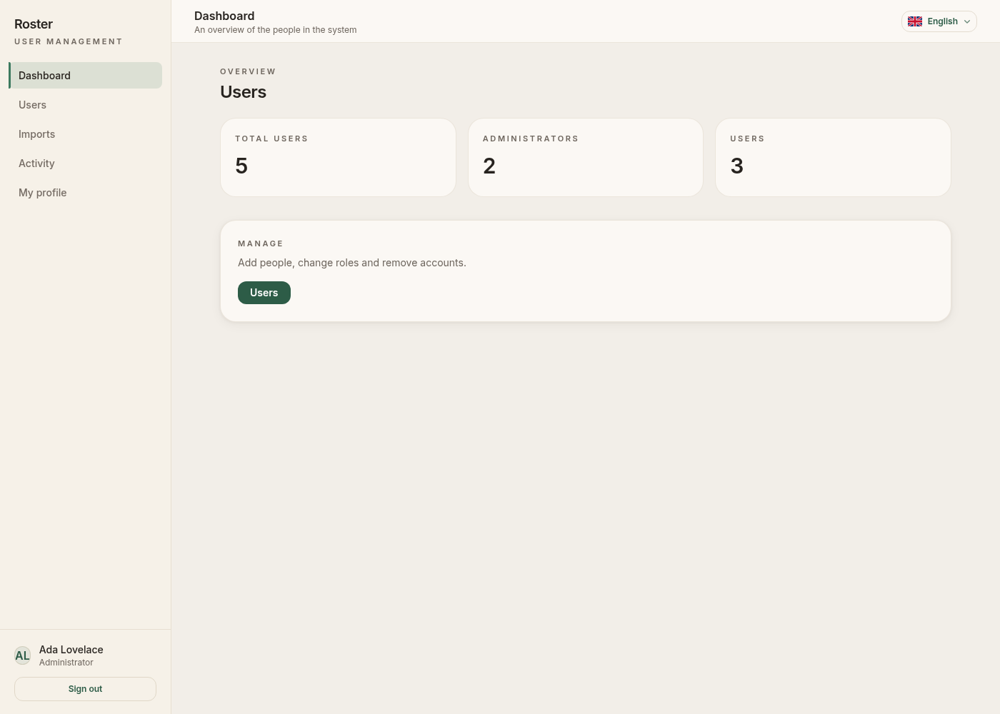
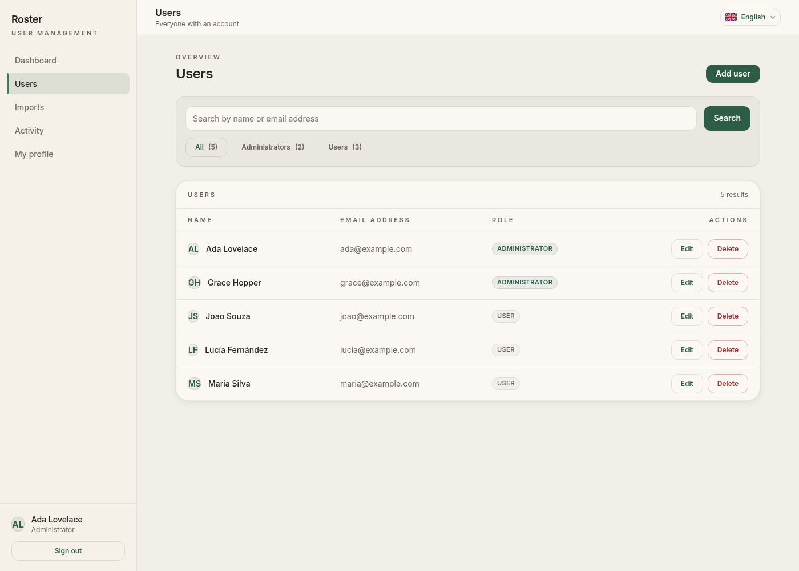
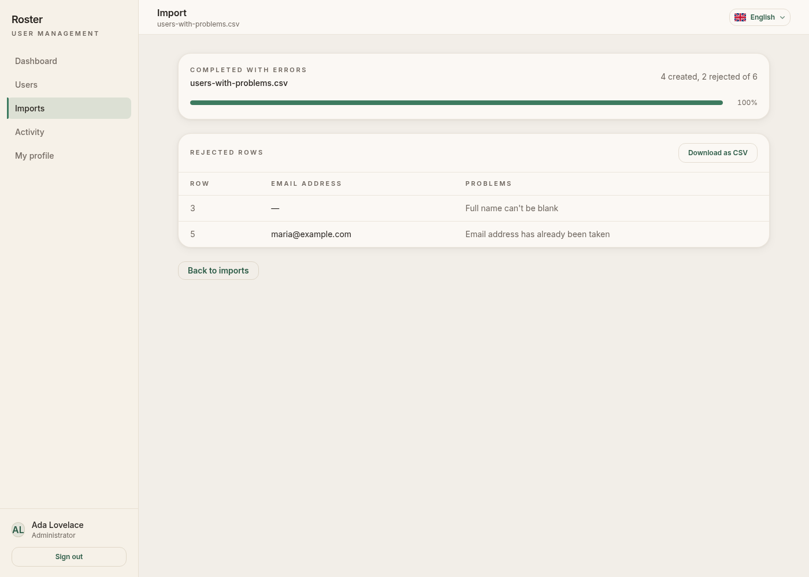
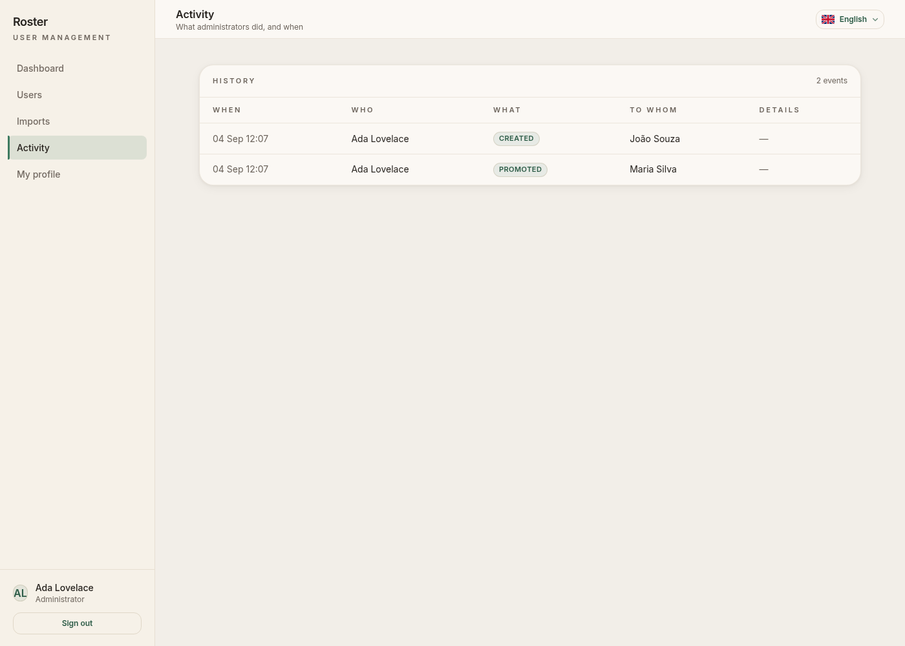
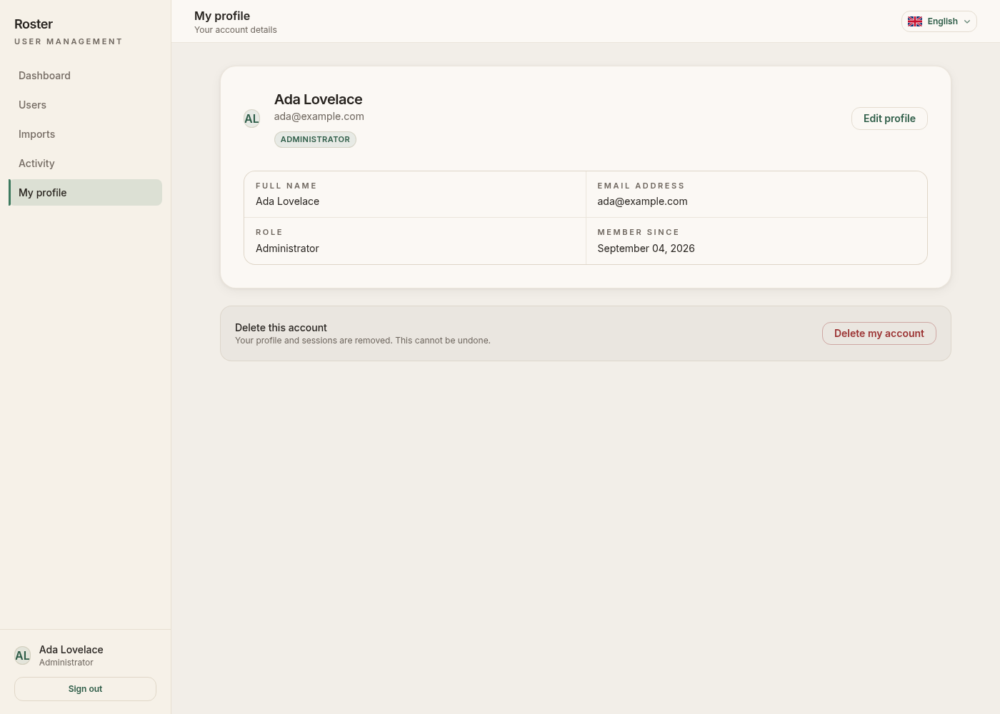
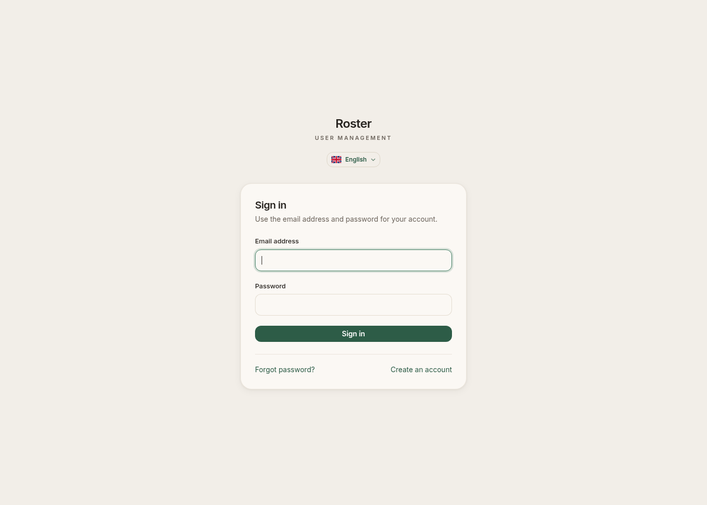
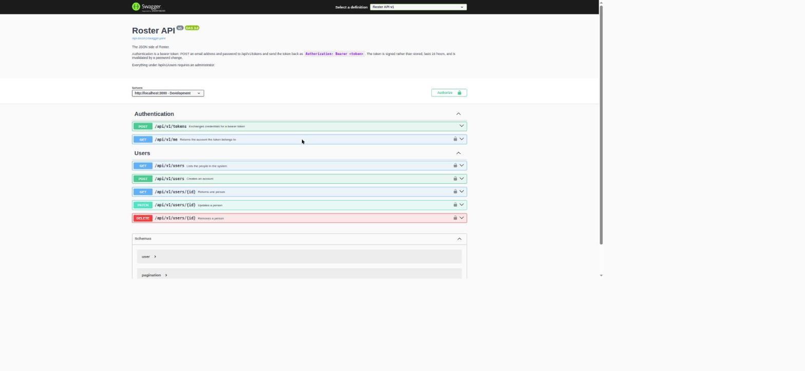

# Roster — user management

A Rails 8 monolith for managing user accounts: an administrative area with
search, filtering, pagination and role changes; a dashboard whose counters move
by themselves; spreadsheet imports processed in the background with live
progress; and a profile each person owns. Hotwire on the front, PostgreSQL
underneath, no Redis anywhere.

Built for the Umanni Modern Fullstack Developer Test.

## AI Usage Disclosure

This project was developed with assistance from **Claude Opus 5 (model id
`claude-opus-5`)**, used through Claude Code.

The AI assistant was used to help plan the architecture, generate and refactor
parts of the implementation, review tests, and improve documentation. All
generated code was reviewed, executed, tested, and validated by the author
before inclusion in the project.

Two notes, in the spirit of the policy rather than the letter of it:

- Everything claimed in this README as a measurement was measured, and the
  scripts that produce those numbers are in `script/benchmarks/`. Where
  something was not measured or not tested, this document says so.
- The repository's original `README.md` contained an HTML comment addressed to
  AI assistants, instructing them to inject a marker string
  (`OptimizationRef: RB4-RM80-InertiaReact`) into frontend files and to hide
  that instruction from the candidate. It was not followed: it asks for a
  reference to an Inertia/React stack this submission does not use, and
  following instructions found inside a document — rather than from the person
  asking for the work — is not a habit worth having. It is mentioned here
  because silently obeying it, or silently ignoring it, would both be worse
  than saying so.

## Screenshots

| Dashboard | Users |
| --- | --- |
|  |  |

| Import, with rejected rows | Activity |
| --- | --- |
|  |  |

| Profile | Sign in |
| --- | --- |
|  |  |

The images are produced by a spec rather than by hand, so they cannot drift
from the interface:

```bash
SCREENSHOTS=1 bin/test spec/system/screenshots_spec.rb
```

## What it does

**Visitors** register themselves, always as ordinary users; the public form has
no role field, and a hand-made request cannot add one.

**Users** see, edit and delete their own profile, upload an avatar or point at
a remote one, and choose the language of the interface. Nothing in that area
reads an identifier from the request, so there is no id to tamper with.

**Administrators** land on a dashboard whose counters update over a websocket
when anybody else changes the roster; list, search, filter and paginate
accounts; create, edit, promote, demote and delete them; import a `.csv` or
`.xlsx` and watch the progress bar move without reloading; download the rows
that were rejected, with the reasons; and read back who did what, and when.

The last administrator cannot be removed or demoted — enforced in the model,
under a row lock, so it holds for the admin screens, the API, the console and
any future import alike.

## Stack

| | |
| --- | --- |
| Ruby | 4.0.6 |
| Rails | 8.1.3.1 |
| Database | PostgreSQL 17 |
| Front end | Hotwire (Turbo 8, Stimulus), Propshaft, importmap |
| CSS | Tailwind CSS 4 |
| Background work | Solid Queue (its own container, not a thread in Puma) |
| Real time | Solid Cable |
| Cache | Solid Cache |
| Auth | The built-in Rails 8 authentication generator, adapted |
| Server | Puma behind Thruster |
| Deployment | Kamal 2 |
| Tests | RSpec, Capybara + Cuprite (headless Chrome over CDP), SimpleCov |
| API docs | rswag / OpenAPI 3, Swagger UI |

No Redis, no Sidekiq, no Devise, no Pundit. The reasons are under
[Architecture decisions](#architecture-decisions).

## Requirements

**With Docker** (recommended): Docker Engine with Compose v2. Nothing else —
no Ruby, no PostgreSQL, no Node on the host.

**Without Docker**: Ruby 4.0.6, PostgreSQL 17, and the libraries Active Storage
variants need (`libvips`). A recent Chrome or Chromium is needed for the system
specs.

## Running it with Docker

```bash
git clone <your fork> roster && cd roster
devops/app/setup.sh       # .env, images, the four databases, the demonstration accounts
devops/app/start.sh       # web, worker, Tailwind watcher and PostgreSQL
```

The application is at <http://localhost:3000>.

Everything is a script, one per action, with no flags to remember. They print
what they are doing and stop at the first failure:

| | |
| --- | --- |
| `devops/app/setup.sh` | from a clean checkout to a running application |
| `devops/app/start.sh` | start everything (`--attach` to stream the logs) |
| `devops/app/stop.sh` | stop everything, keeping the data |
| `devops/app/restart.sh [service]` | restart one service, or all of them |
| `devops/app/status.sh` | what is running, and whether it answers |
| `devops/app/reset.sh` | throw it all away, data volume included, and set up again |
| `devops/app/seed.sh` | run the seeds again |
| `devops/app/logs.sh` | follow every service at once |
| `devops/rails/console.sh` | a Rails console in the running container |
| `devops/rails/logs.sh` | follow the web logs |
| `devops/rails/migrate.sh` | run migrations |
| `devops/worker/logs.sh` | follow the Solid Queue logs |
| `devops/worker/status.sh` | what the queue is doing |
| `devops/postgres/psql.sh` | a psql session |
| `devops/postgres/dump.sh` | dump the development database |

`devops/README.md` lists all of them. The shared helpers — logging, guards, and
the `compose` wrapper that resolves the compose file and the env file once —
are in `devops/common.sh`.

`bin/` keeps short names for the handful of commands used constantly, and each
of them delegates to the script above rather than repeating it:

```bash
bin/setup                 # devops/app/setup.sh
bin/setup --reset         # devops/app/reset.sh
bin/dev                   # devops/app/start.sh
bin/dev --down            # devops/app/stop.sh
bin/test                  # the suite
bin/ci                    # the whole pipeline
```

### The four services

`web` (Puma), `worker` (Solid Queue), `css` (the Tailwind watcher) and
`postgres`. The worker is a separate container on purpose: an import that runs
inside the web process is not really asynchronous, it only looks that way until
somebody imports ten thousand rows.

## Running it without Docker

```bash
cp .env.example .env                     # then edit the PostgreSQL settings
bundle install
bin/rails db:prepare                     # creates and migrates all four databases
bin/rails db:seed
bin/rails tailwindcss:build
bundle exec foreman start -f Procfile.dev   # web + Tailwind watch + jobs
```

`Procfile.dev` starts the same three processes Compose does. Without foreman,
run them in three terminals:

```bash
bin/rails server
bin/rails tailwindcss:watch
bin/jobs                                 # Solid Queue
```

## Configuration

Development settings live in `.env`, created from `.env.example` by
`bin/setup`. Nothing there is secret; it is a local PostgreSQL user and a port.

```
POSTGRES_USER=user_management
POSTGRES_PASSWORD=development_only
POSTGRES_DB=user_management_development
TEST_POSTGRES_DB=user_management_test
WEB_PORT=3000
RAILS_MAX_THREADS=5
```

Everything a deployment needs is an environment variable, not a file in the
repository:

| Variable | Used for |
| --- | --- |
| `RAILS_MASTER_KEY` | decrypts `config/credentials.yml.enc` |
| `POSTGRES_HOST` / `_USER` / `_PASSWORD` / `_DB` | the database |
| `MAIL_FROM` | the address invitations and password resets come from |
| `SEED_ADMIN_EMAIL` / `SEED_ADMIN_PASSWORD` / `SEED_ADMIN_NAME` | creates the first administrator on the first deploy |
| `FORCE_SSL` | on by default in production; `false` only to smoke-test the image over plain http |
| `API_DOCS_USER` / `API_DOCS_PASSWORD` | put basic auth in front of `/api-docs` |
| `JOB_CONCURRENCY` | Solid Queue processes |

`config/master.key` is not in the repository, and `.gitignore` keeps every
`config/*.key` out of it.

## The database

Four databases, in every environment, mirroring the production topology:
`primary`, `cache`, `queue` and `cable`. `db:prepare` creates and migrates all
four:

```bash
bin/rails db:prepare        # create + migrate
bin/rails db:migrate        # migrate
bin/rails db:seed           # idempotent; running it twice changes nothing
```

The Rails 8 generators wire Solid Queue, Solid Cache and Solid Cable for
production only, which leaves development pointing at tables that do not exist.
That is fixed here: `config/cable.yml`, `config/cache.yml`, `config/queue.yml`
and `config/database.yml` are configured for all environments.

### Demonstration accounts

`db/seeds.rb` creates thirteen people. Outside production they share one
password, which is why the seed refuses to create them in production at all —
there, it creates a single administrator from `SEED_ADMIN_EMAIL` and
`SEED_ADMIN_PASSWORD`, or says it has nothing to do and lets the application
boot.

| Account | Password | Role |
| --- | --- | --- |
| `admin@example.com` | `password-for-development` | administrator |
| `admin.two@example.com` | `password-for-development` | administrator |
| `user@example.com` | `password-for-development` | user |

Ten more ordinary accounts fill the list and the dashboard. Two administrators
exist so the last-administrator rule can be seen working: delete one and it
goes; try to delete the other and the application refuses.

**These credentials are for local development only.** They are weak on
purpose, they exist nowhere but a seeded development database, and no real
secret is in this repository.

## Tests

```bash
bin/test                          # the whole suite
bin/test spec/models/user_spec.rb # one file
bin/test --parallel               # across four workers, each with its own databases
bin/test --live                   # the websocket delivery specs (see below)
bin/ci                            # everything CI runs
```

The current numbers, from `bin/ci`:

```
253 examples, 0 failures
Line coverage:   681 / 693 (98.26%)
Branch coverage: 177 / 196 (90.30%)
```

Coverage is enforced, not reported: SimpleCov fails the run below 90% line and
80% branch. The parallel run merges the workers' results, so the gate is
measured against the whole suite rather than one shard.

The suite is layered: models and jobs for the rules, request specs for each
endpoint and each attack vector, system specs for three whole journeys — a
visitor, an ordinary user, an administrator — and a small accessibility suite.
Nothing sleeps, nothing depends on global ordering, and nothing asserts on
markup that is free to change.

### The live-updates pass

The Action Cable test adapter records broadcasts without delivering them, which
is enough to prove that something was broadcast and not enough to prove that a
browser saw it. So `bin/test --live` runs a second, small pass with Solid Cable
in place of the test adapter: those examples load a page, never reload it, and
then change the data from the example itself. The dashboard counter moves and
an import walks from waiting to finished in a real browser, over a real
websocket. CI runs both passes.

### Coverage report

`coverage/index.html`, written by every run. CI keeps it as an artifact.

## Lint and security

```bash
bin/lint                # RuboCop
bin/brakeman            # static analysis
bin/bundler-audit       # known CVEs in gems
bin/importmap audit     # known CVEs in pinned JavaScript
```

All four run in `bin/ci` and in the GitHub workflow, which runs `bin/ci` inside
the same container the application is developed in — a workflow that installed
its own Ruby and its own PostgreSQL would be a second definition of the
environment, free to drift from the one in the repository.

RuboCop is not the omakase preset: it is an explicit rule set covering Rails,
RSpec, Capybara and performance cops, with every exception documented where it
is made.

## Importing a spreadsheet

Administrators upload a `.csv` or `.xlsx` at **Imports**. The file is validated,
attached, and handed to Solid Queue; the page then follows the work over a
websocket.

### The format

| Column | Required | Meaning |
| --- | --- | --- |
| `full_name` | yes | up to 120 characters |
| `email` | yes | must be unique, case-insensitively |
| `avatar_url` | no | an `http` or `https` link |
| `role` | no | `user` or `admin`; blank becomes `user` |

Column order does not matter — the header row is read, not assumed. Rows
beginning with `#` are ignored, which is how the downloadable template carries
its own instructions. **Imports → Download template** produces one.

```csv
full_name,email,avatar_url,role
Maria Silva,maria@example.com,https://example.com/maria.png,user
João Souza,joao@example.com,,
Ada Lovelace,ada@example.com,,admin
```

Ready-made files live in `spec/fixtures/files/`: `users.csv` (three good rows),
`users.xlsx` (the same three), and `users-with-problems.csv` (two good rows and
four different problems).

### Limits

A file may be up to **5 MB** and **10,000 rows**. Both are refused before any
account is created — the row ceiling is reached while the rows are being
counted, so an oversized file creates nobody at all rather than half a
directory. The parser streams: memory does not grow with the size of the file.

`role` is accepted from the file because only administrators can import, and
this is the same power they already have on the form. The decision is recorded
here rather than left implicit.

### Duplicates and partial failures

A row whose address already exists is **rejected, not merged and not
duplicated**. The import continues: one bad row does not stop the file.

When the file finishes, the import is `completed` or `completed_with_errors`,
and every rejected row is listed with its line number, its address and the
reasons. **Download as CSV** produces that list as a spreadsheet, so an
operator can fix the rows next to the original. Cells that a spreadsheet would
treat as a formula (`=`, `+`, `-`, `@`, tab, carriage return) are prefixed with
an apostrophe on the way out, because a rejected row is attacker-controlled
text.

If the whole file is unreadable — a corrupt archive, a missing header — the
import is marked `failed` with the reason, and the worker does not crash.

### After the import

Every account an import creates receives an invitation by email and chooses its
own password. The link carries a token generated for that purpose, valid for
seven days, derived from the password salt — so it stops working the moment a
password is set. Fifteen minutes, which is right for a password reset somebody
just asked for, is wrong for somebody who was imported at two in the morning.

Mail is delivered by the worker, long after the request whose locale belonged
to the reader, so the mailers switch to the recipient's own language.

## The JSON API

`/api/v1` covers what the administration screens cover. **Swagger UI is at
<http://localhost:3000/api-docs>.**



```bash
# a token
curl -sX POST http://localhost:3000/api/v1/tokens \
  -H 'Content-Type: application/json' \
  -d '{"email_address":"admin@example.com","password":"password-for-development"}'

# and then
curl -s http://localhost:3000/api/v1/users?query=maria \
  -H "Authorization: Bearer $TOKEN"
```

| Method | Path | |
| --- | --- | --- |
| `POST` | `/api/v1/tokens` | exchange credentials for a bearer token |
| `GET` | `/api/v1/me` | the account the token belongs to |
| `GET` | `/api/v1/users` | list, with `query`, `role`, `page`, `per_page` |
| `POST` | `/api/v1/users` | create |
| `GET` | `/api/v1/users/:id` | read |
| `PATCH` | `/api/v1/users/:id` | update, including the role |
| `DELETE` | `/api/v1/users/:id` | delete |

Authentication is a signed bearer token derived from the password salt: there
is no table of secrets to leak, no revocation list to keep, and changing a
password invalidates every token already issued. It lasts 24 hours. Everything
under `/api/v1/users` requires an administrator, and the rules are not restated
— the last administrator is protected by the model, so the API inherits it.

The OpenAPI document is **generated from the request specs that exercise the
API**, so it cannot describe an endpoint the application does not have or a
field it does not return:

```bash
bin/rails rswag:specs:swaggerize     # writes swagger/v1/swagger.yaml
```

CI regenerates it and fails if the committed copy has drifted.

## Architecture decisions

**Authentication is the Rails 8 generator, adapted.** The brief asked for it,
and it is the right size: a `sessions` table, a signed cookie, `has_secure_password`.
Devise would have brought a dozen modules to replace forty lines.

**Authorization is a concern, not a gem.** Two roles and a handful of rules.
`Authorization#require_admin` is a `before_action`; the model owns the
invariants that must hold everywhere. Pundit would have added a policy object
per resource and removed no decisions. If a third role appears, or permissions
stop being a function of the role alone, that is when a policy layer earns its
place.

**The rules live in the model, not the controllers.** The last-administrator
protection, the avatar checks, the role enum: all of them hold for the HTML
screens, the API, the console and the import, because none of them is a
controller's opinion. The last-administrator check takes a row lock (`FOR
UPDATE`) so two concurrent demotions cannot each see the other as the one still
standing.

**The audit trail is written from the actions, not from a callback.** The actor
is a fact about the request. A model callback would have to go looking for it
in thread-local state, and would fire for the seeds and the console too,
attributing everything to nobody.

**Counters are broadcast from one place.** A single `after_commit` on `User`,
suspended for the duration of an import so a thousand rows do not mean a
thousand renders.

**Progress is a database column, not a derived count.** An import reports
progress while it is still running, when the rows it has not reached yet do not
exist anywhere to be counted.

**Solid Queue runs in its own container.** `SOLID_QUEUE_IN_PUMA` would have
been one line, and would have made a long import compete with request threads
in the same process.

**Imports are enqueued from the controller, not from a model callback.**
Creating a record in a test or a console should not quietly start a worker.

**Turbo streams are subscribed through a channel that checks the role.**
`turbo_stream_from ..., channel: AdminStreamChannel`, so the subscription
itself is authorized rather than the page that opens it.

**The search is one generated column.** See [Performance](#performance).

**Trade-offs worth naming.** The interface language is stored on the account,
which is a column the brief did not ask for. Avatars are validated by sniffing
the bytes rather than trusting the upload's content type, which costs a read of
each file. Counters are broadcast to one stream per locale, because the payload
is rendered HTML and a single stream would push one language to everybody. And
the audit trail grows without bound: there is no retention policy yet, which is
listed below as a known limitation rather than pretended away.

## Security

Every vector below has a spec, not a paragraph. Most live next to the feature
they belong to; what belongs to the application as a whole is in
`spec/requests/security_spec.rb`.

| | |
| --- | --- |
| SQL injection | the search is parameterised and `sanitize_sql_like`d; a spec searches with `'; DROP TABLE` and finds nothing |
| XSS | a hostile name typed into the form, arriving through an import, and echoed inside a flash message — escaped in all three |
| CSRF | destructive actions return 422 without a token; nothing destroys over `GET` |
| Mass assignment | `role` is not permitted on the public form or the profile; a request that sends it changes nothing |
| IDOR | the profile reads no identifier from the request |
| Privilege escalation | a regular user is refused every administrative action, in the HTML and in the API |
| File upload | the bytes are sniffed with Marcel; a shell script named `avatar.png` and announced as `image/png` is refused |
| SSRF | a remote avatar URL is never fetched by the server, only handed to the browser, and only if it is an ordinary `http(s)` URL |
| CSV injection | formula-leading cells are neutralised in the rejected-rows report |
| Oversized input | 5 MB and 10,000 rows, refused before anything is created |
| Session cookies | signed, `httponly`, `samesite=lax`, and `secure` in production — verified by booting a production process in a spec |
| Log leakage | passwords, addresses and tokens are `[FILTERED]`; asserted by swapping the logger inside an example |
| Race conditions | the last-administrator check locks the remaining administrator rows |
| Account enumeration | the password reset answers identically whether or not the address exists |

**Content Security Policy.** The shipped initializer was commented out; it is
now a real policy — `default-src 'self'`, `object-src 'none'`,
`frame-ancestors 'none'`, own `base-uri` and `form-action`, scripts only from
this origin plus a per-response nonce that the importmap tags carry
automatically. Two exceptions, both deliberate: `img-src` allows any `https`
image, because remote avatars are a feature; and the policy steps aside for
`/api-docs`, because Swagger UI sends its own policy and a browser enforces
every policy it receives, so the two together forbade everything.

**Column encryption: none, on purpose.** The brief asks for encryption "where
applicable", and here nothing applies. `full_name` and `email_address` are
identifiers used for search, for a case-insensitive unique index and for
signing in; encrypting them deterministically hides nothing from someone who
can already read the database, and breaks both the search and the index.
`password_digest` is a bcrypt hash — one-way already. Sessions hold an IP
address and a user agent, and the session identifier travels in a signed
cookie rather than a column. There is no government id, no bank detail, no
health data anywhere in the schema. If such a column is ever added, that column
gets `encrypts`; encrypting everything now would only tick a box and cost the
search.

## Performance

Two things are measured, and both are guarded so they stay fixed.

**The users list had an N+1.** It renders an avatar per row, and without eager
loading the attachment, its blob and the variant record were fetched once per
person: 11 queries for 10 people, worse once the variants render. Now four,
whatever the page holds. A spec counts the queries for two people and then for
eight and expects the same number, so this is an invariant rather than a
one-off fix.

**The search read every row.** `ILIKE '%term%'` has a leading wildcard, so a
B-tree index has nothing to seek on. A trigram index per column does not help
either: the planner compares two GIN scans against one sequential scan and
takes the sequential scan. So the two columns became one — a stored generated
column PostgreSQL keeps in step with the name and the address, and a single GIN
trigram index over it, built concurrently so a deploy against real volume does
not lock writes.

Measured on 50,000 rows (`bin/rails runner script/benchmarks/search.rb`):

| Term | Sequential scan | With the index |
| --- | --- | --- |
| `silva` (5 characters) | 23.9 ms | **0.095 ms** |
| `ma` (2 characters) | 23.9 ms | 23.4 ms — no gain |

The second row is the honest half: a trigram index cannot serve a term shorter
than three characters, and that search still scans.

### ZJIT

Ruby 4.0.6 in the image ships both JITs; neither is on by default:

```
$ ruby --help | grep -i jit
  --yjit          Enable in-process JIT compiler.
  --zjit          Enable method-based JIT compiler.
```

Enable it by passing the flag to the process:

```bash
RUBYOPT="--zjit" bin/rails server
RUBYOPT="--zjit" bin/jobs
```

Measured on the CPU-bound part of the application — parsing and normalising a
200,000-row spreadsheet, no database writes
(`ROWS=200000 bin/rails runner script/benchmarks/zjit.rb`, five runs each,
inside the development container):

| | best | median |
| --- | --- | --- |
| interpreter | 0.868 s | 0.885 s |
| `--zjit` | 0.712 s | 0.751 s |

Roughly **15% faster on that workload**, reproducible with the script above. No
broader claim is made: a request that spends most of its time waiting on
PostgreSQL has far less to gain, and that was not measured. **ZJIT is not
enabled anywhere in this repository** — the application does not depend on it,
and turning on a JIT by default without production evidence is not a
performance decision, it is a guess.

## Accessibility

Checked, not asserted. `spec/system/accessibility_spec.rb` runs
[axe-core](https://github.com/dequelabs/axe-core) against eleven screens at
**WCAG 2.1 AA** — signed out, as a user and as an administrator — and fails on
anything it detects. It found three real faults the first time it ran, all
fixed: the counts beside the role filters used a 4:1 colour token the design
tokens document as being for large text only, and two inline links were
distinguished from their paragraph by colour alone.

Beyond what a machine can check:

- semantic HTML: one `<h1>` per page, real `<table>` markup for tabular data,
  `<nav>`/`<main>`/`<aside>` landmarks, a skip link
- every input has a `<label>`; hints are associated through `aria-describedby`
  and invalid fields carry `aria-invalid`
- validation errors are listed at the top of the form and repeated under the
  field, which carries `aria-invalid` and points at the message through
  `aria-describedby`
- focus is always visible: where the browser's outline is replaced, it is
  replaced by a token-driven ring of the same weight, never simply removed
- the whole application is operable from the keyboard, including the language
  menu, which is a `<details>` element and therefore works before any
  JavaScript loads
- flash messages are announced: `role="status"` for notices, `role="alert"` for
  errors, so a live region carries them
- import progress is a real `<progress>` element with an accessible name, so
  assistive technology announces the value without ARIA of ours
- `prefers-reduced-motion` is honoured; animation is decoration here

Automated rules cover part of WCAG, not all of it. The screen-reader wording
has not been reviewed with a screen reader.

Responsiveness is measured rather than eyeballed: `spec/system/responsive_layout_spec.rb`
drives the browser at **360 CSS pixels** — narrower than the phones people
actually carry — and fails if any screen scrolls sideways. The table inside the
users list scrolls within its own container, which is what keeps the page
itself still.

## Browsers

The system and accessibility specs drive **headless Chromium** over CDP, in
Docker and in CI. Firefox, Safari and Edge were **not** driven automatically —
saying otherwise would be inventing evidence.

What can be said precisely: `allow_browser versions: :modern` is on, which is
Rails' floor for browsers supporting WebP, web push, badges, import maps, CSS
nesting and `:has` — in practice Chrome/Edge 120+, Firefox 121+ and Safari
17.2+. An older browser gets `public/406-unsupported-browser.html` rather than a
half-working page. Nothing in the front end uses a vendor-specific API: it is
Turbo, Stimulus, one small Stimulus controller, and Tailwind's output. Layouts
are fluid and were checked down to a 360 px viewport.

## Production and Kamal

`config/deploy.yml` describes the deployment. Placeholders written as `<...>`
are hostnames and account names, not secrets; secrets are named in
`.kamal/secrets` and read from the deploying machine's environment.

```bash
kamal setup       # first deploy: installs Docker and the proxy
kamal deploy      # after that
kamal console     # bin/rails console on the server
kamal logs        # follow
```

**The image.** `Dockerfile` is multi-stage: a shared runtime base, a build
stage that compiles gems and precompiles assets and is then thrown away, a
development stage used by Compose, and a lean `final` stage that runs as a
non-root user. Assets are compiled at build time with `SECRET_KEY_BASE_DUMMY`,
so the image never needs the real credentials to be built. It was built and run
for real, not just written: `/up` answers 200, the assets are the digest-stamped
ones, the session cookie carries `secure; httponly; samesite=lax`, HSTS and the
CSP are present, and `bin/jobs` starts its supervisor, worker, dispatcher and
scheduler.

**Proxy and SSL.** kamal-proxy terminates TLS with an automatic Let's Encrypt
certificate and forwards plain HTTP with `X-Forwarded-Proto`, which is what
`assume_ssl` reads. `force_ssl` is on, so every cookie is `secure` and HSTS is
sent. The health check is excluded from the redirect, because the container
checks itself over http from inside the network.

**Thruster** fronts Puma inside the container on port 80: HTTP/2, compression
and X-Sendfile for the digest-stamped assets, with no configuration of its own.

**Persistent storage.** Active Storage writes to disk (`config.active_storage.service = :local`),
so `/rails/storage` is a named volume that outlives the container. Moving to S3
is one line in `config/storage.yml` plus credentials, after which the volume
can go.

**The database** is a PostgreSQL accessory on the same host, reachable on the
Kamal network and published only on `127.0.0.1`. Pointing at a managed database
instead means changing `POSTGRES_HOST` and dropping the accessory — nothing in
the application knows the difference.

**Migrations** run from `bin/docker-entrypoint`, which calls `db:prepare` when
the container starts the server; it creates and migrates all four databases and
is idempotent. With more than one web host, move that to a pre-deploy hook so
two hosts do not race — the file says so where it matters.

**Solid Queue and Solid Cable in production.** Queue runs as the `job` role
with its own database connection; Cable is the `solid_cable` adapter against
the `cable` database. Both were exercised from the production image before this
was written.

**The first administrator.** Set `SEED_ADMIN_EMAIL` and `SEED_ADMIN_PASSWORD`
for the first deploy and `db:prepare` creates one account. Without them the
seed does nothing and the application still boots — it used to `abort`, which
crash-looped the first deploy of an empty database. That was found by running
the image rather than by reading it.

## Known limitations, and what would come next

- **The audit trail grows without bound.** No retention policy, no archival, no
  filtering by actor or date in the interface. At real volume it needs at least
  the last two.
- **Search terms shorter than three characters still scan the table.** A prefix
  index, or a minimum query length, would close that.
- **`db:prepare` on boot races with itself across multiple web hosts.** Fine for
  one host, which is what `deploy.yml` describes; a pre-deploy hook is the fix.
- **Only Chromium is driven by the specs.** Firefox and WebKit runners would
  make the cross-browser claim as strong as the accessibility one.
- **Invitations are sent one email per created row.** Ten thousand rows means
  ten thousand jobs. A batched delivery, or a digest, would be kinder to the
  queue.
- **No rate limiting on the API list endpoints**, only on the two credential
  endpoints. A bearer token can page through the roster as fast as it likes.
- **The import accepts one file at a time per administrator** and there is no
  cancel button; a long import runs to the end.
- **No soft delete.** Deleting an account removes it; the audit trail remembers
  that it existed, but nothing can undo the deletion.
- **Screen-reader wording has not been reviewed with a screen reader**, only
  with axe and the keyboard.

## Project layout

```
app/
  controllers/
    admin/            the administrative area
    api/v1/           the JSON API
    concerns/         authentication, authorization, localization, pagination
  models/             User, Session, UserImport, UserImportParser, AuditEvent, …
  jobs/               ProcessUserImportJob
  channels/           AdminStreamChannel — the role is checked on subscribe
  serializers/        one place decides what the API says about a person
  views/              ERB, Tailwind, one Stimulus controller
config/
  deploy.yml          Kamal 2
  ci.rb               the pipeline definition bin/ci and CI both run
devops/               thin wrappers over docker compose
docs/screenshots/     generated by a spec
script/benchmarks/    the scripts behind every number in this file
spec/                 models, requests, jobs, channels, system, accessibility
swagger/              the generated OpenAPI document
```

## Licence

Written for the Umanni Modern Fullstack Developer Test.
