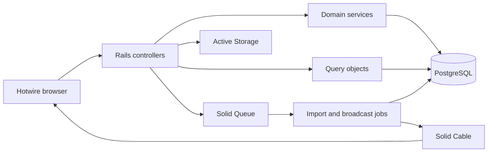

### AI Usage Disclosure

OpenAI Codex (GPT-5) assisted with architecture, implementation, tests, documentation, and iterative review. Every generated change was inspected and validated through automated tests, static analysis, a production Docker build, and interactive browser testing.

# Umanni Users

[](https://github.com/tilipim123/Fullstack-Developer/actions/workflows/ci.yml)
[](https://github.com/tilipim123/Fullstack-Developer/actions/workflows/codeql.yml)

A responsive Rails 8 monolith for secure user and role management, real-time dashboard statistics, and resilient background spreadsheet imports. It uses native Rails components end to end and requires no Redis or frontend build service.

## What is implemented

- Visitors can register with a name, unique email, password, and uploaded or remote HTTPS avatar. Self-registration always creates a standard user.
- Standard users are redirected to their own profile and can only view, edit, or delete that account.
- Administrators are redirected to a live dashboard and can search, create, edit, delete, promote, and demote users.
- The final administrator is protected from concurrent demotion or deletion.
- CSV and XLSX imports run asynchronously, retain per-row outcomes, tolerate partial failure, and publish live progress.
- Dashboard totals update through Turbo Streams whenever users or roles change.
- Authentication uses the Rails 8 generator, secure signed cookies, session revocation, password recovery, and rate limiting.
- The UI is responsive, keyboard-accessible, and built with Hotwire, Stimulus, Propshaft, and Tailwind CSS.

## Technology

| Concern | Choice |
| --- | --- |
| Runtime | Ruby 4.0.6 with ZJIT in the production image |
| Framework | Rails 8.1.3.1 |
| Database | PostgreSQL 17 |
| Frontend | Turbo 8, Stimulus, Importmap, Propshaft, Tailwind CSS 4 |
| Background work | Solid Queue |
| Real-time updates | Solid Cable + Turbo Streams |
| Cache | Solid Cache |
| Uploads | Active Storage |
| Spreadsheet parsing | Roo (CSV and XLSX) |
| Tests | Minitest, Capybara, Selenium/Chromium, SimpleCov |
| Delivery | Multi-stage Docker, Thruster, Docker Compose, Kamal 2 |

## Architecture

The application is deliberately a modular monolith. Controllers handle HTTP orchestration, models protect persistence invariants, service objects own use-case rules, query objects own read composition, and jobs provide durable asynchronous boundaries.



The boundaries and design decisions are described in [docs/architecture.md](docs/architecture.md). Security controls are documented in [docs/security.md](docs/security.md), the browser acceptance inventory is in [docs/qa-inventory.md](docs/qa-inventory.md), and the completed validation evidence is in [docs/qa-report.md](docs/qa-report.md).

## Run with Docker

Docker is the recommended path because it pins Ruby, PostgreSQL, Chromium, and the native dependencies.

```bash
git clone https://github.com/tilipim123/Fullstack-Developer.git
cd Fullstack-Developer
git switch feature/senior-user-management
docker compose up --build -d
docker compose run --rm web bin/rails db:seed
```

Open [http://localhost:3000](http://localhost:3000). Compose starts:

- `database`: PostgreSQL 17 with a persistent volume and health check;
- `setup`: one-shot preparation of the application, cache, queue, and cable databases;
- `web`: non-root production Rails image behind Thruster on port 3000;
- `jobs`: a dedicated Solid Queue supervisor.

Demo credentials created by the idempotent seed:

| Role | Email | Password |
| --- | --- | --- |
| Administrator | `admin@example.com` | `SecurePass123!` |
| Standard user | `member@example.com` | `SecurePass123!` |

These credentials are for local evaluation only. Stop the stack with `docker compose down`.

## Local development

Prerequisites are Ruby 4.0.6, PostgreSQL 17, and Chromium/Chrome for system tests.

```bash
cp .env.example .env
set -a && source .env && set +a
bundle install
bin/setup
bin/dev
```

`bin/dev` starts Rails, the Tailwind watcher, and Solid Queue. Seed at any time with `bin/rails db:seed`; the operation is idempotent.

## Configuration

No real secret is committed. Environment variables configure the runtime, while Rails credentials may supply SMTP values in production.

| Variable | Purpose | Local default |
| --- | --- | --- |
| `DB_HOST`, `DB_PORT` | PostgreSQL endpoint | `127.0.0.1:5432` |
| `DB_USERNAME`, `DB_PASSWORD` | PostgreSQL credentials | `postgres` / `postgres` |
| `APP_HOST`, `APP_PROTOCOL` | URL generation, host authorization, and HTTPS policy | `localhost` / `http` |
| `SECRET_KEY_BASE` | Cookie/message encryption in production | set by Compose for local evaluation only |
| `SMTP_ADDRESS`, `SMTP_PORT` | Optional SMTP endpoint | file delivery when absent |
| `SMTP_USERNAME`, `SMTP_PASSWORD` | Optional SMTP credentials | none |
| `RAILS_MAX_THREADS` | Rails database/web concurrency | `5` |
| `JOB_CONCURRENCY` | Solid Queue worker processes | `1` |

For encrypted SMTP configuration:

```yaml
smtp:
  address: smtp.example.com
  port: 587
  user_name: example
  password: secret
```

Edit it with `bin/rails credentials:edit`. Environment variables take precedence. Without SMTP, production-like local runs write mail to `storage/mails`, so background jobs remain testable without an external service.

## Spreadsheet imports

Download either template from the import screen or use:

- `public/user_import_template.csv`
- `public/user_import_template.xlsx`

Required columns are `full_name`, `email`, and `avatar_image_url`. Optional `role` accepts `admin`, `user`, `no-admin`, `true`, `false`, `1`, or `0`. Files are limited to 5 MB and 1,000 data rows.

An import persists its status and every row before broadcasting. Valid rows commit independently; invalid or duplicate rows are displayed with an actionable error and never overwrite an existing account. Retrying a partially processed job skips rows already marked successful, and a terminal import is a no-op.

## Tests and quality gates

Run the same complete gate used by CI:

```bash
docker compose --profile tools run --rm test bin/ci
```

Individual commands:

```bash
docker compose --profile tools run --rm test bin/rails test
docker compose --profile tools run --rm test bin/rails test:system
docker compose --profile tools run --rm test bin/rubocop
docker compose --profile tools run --rm test bin/brakeman --quiet --no-pager --exit-on-warn --exit-on-error
docker compose --profile tools run --rm test bin/bundler-audit
docker compose --profile tools run --rm test bin/importmap audit
```

The model/service/controller suite runs in parallel and enforces at least 90% line and 80% branch coverage. System tests execute real browser journeys in headless Chromium. CI also builds the production image, runs CodeQL, replants seeds, and rejects security or lint warnings.

The latest full local execution and interactive production-browser results are recorded in [docs/qa-report.md](docs/qa-report.md).

## Security summary

- Built-in Rails authentication with bcrypt and 12-character minimum passwords.
- Signed, HTTP-only, same-site session cookies; secure cookies on HTTPS; session reset on login; all sessions revoked after password reset.
- Central role authorization, explicit privilege-change endpoint, and strong structural parameters.
- CSRF protection, strict Content Security Policy with per-response nonces, host authorization, safe redirect validation, and login/reset rate limits.
- Parameterized user search with escaped wildcard input and default Rails HTML escaping.
- Extension, content type, size, row-count, HTTPS, and embedded-credential validation for external inputs.
- Database unique indexes, foreign keys, check constraints, and deterministic row locks around the last-admin invariant.
- Sensitive parameters, including spreadsheet row payloads, are filtered from logs.

See [docs/security.md](docs/security.md) for the threat boundaries and production checklist.

## Deployment with Kamal

`config/deploy.yml` provides separate web/job roles, Thruster health checks, a PostgreSQL 17 accessory, persistent Active Storage, TLS termination, and registry configuration.

```bash
cp .kamal/secrets.example .kamal/secrets
export KAMAL_WEB_HOST=server.example.com
export APP_HOST=users.example.com
export KAMAL_IMAGE=your-org/umanni-users
export KAMAL_REGISTRY_USERNAME=your-github-user
bin/kamal config
bin/kamal setup
```

Load values in `.kamal/secrets` from environment variables or a password manager. On multi-host deployments, replace local Active Storage with an object-storage service; the included named volume is intentionally scoped to a single-host evaluation deployment.

## Trade-offs

- A modular monolith keeps transactions, authorization, deploys, and operations understandable for the current scope. No network boundary justifies a microservice here.
- PostgreSQL-backed queue/cache/cable adapters remove Redis operational overhead while retaining durable jobs and streams.
- Imported users receive expiring password-setup links instead of a shared/default password.
- Uploaded images are durable Active Storage records. Remote avatars are never fetched server-side, avoiding an SSRF boundary; the browser uses no-referrer requests and falls back to initials when unavailable.
